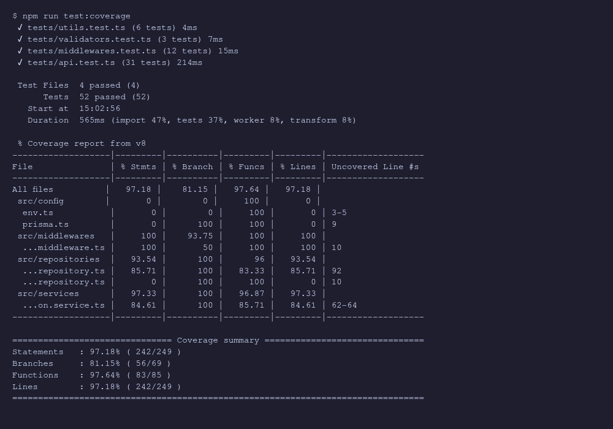
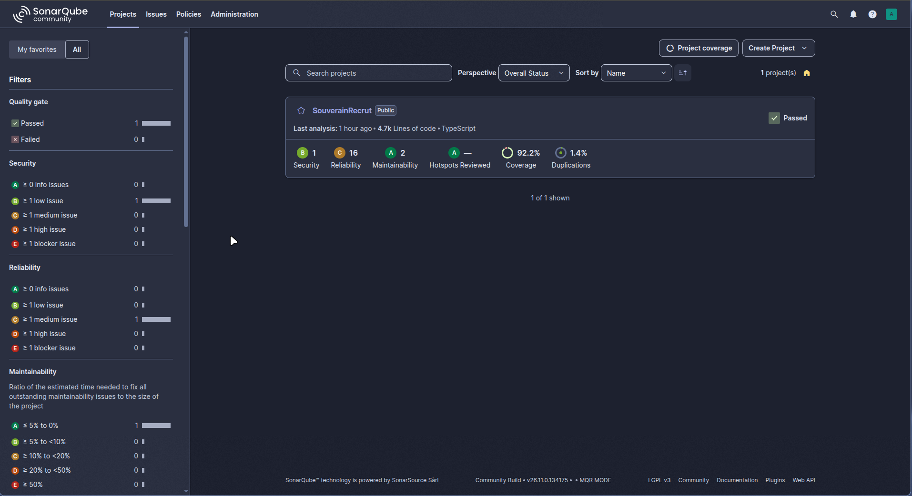
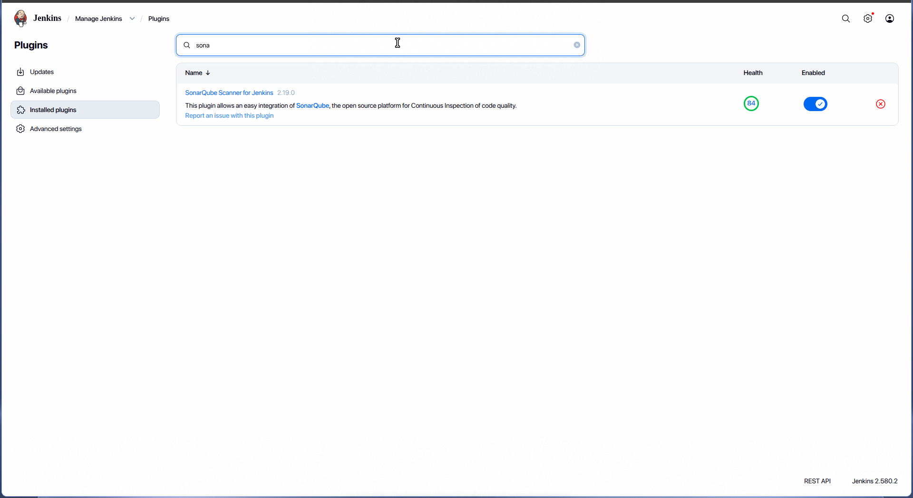
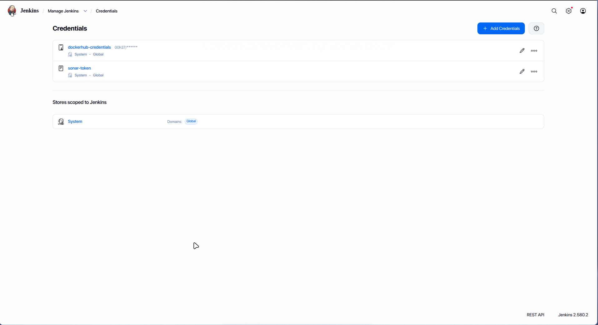
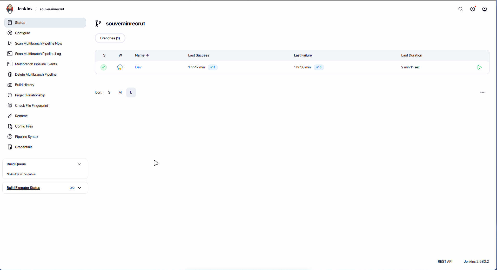
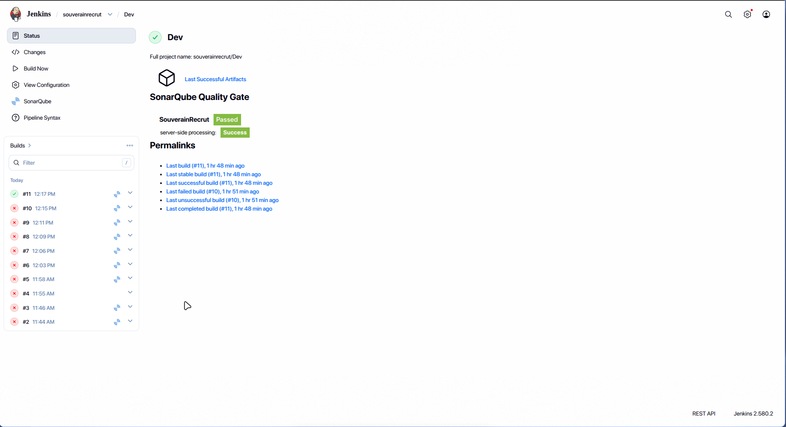
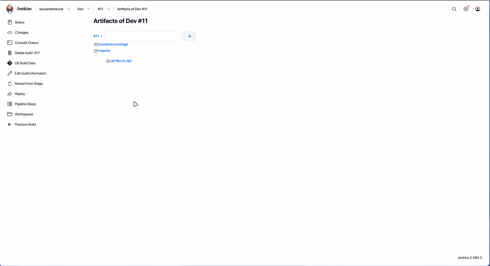
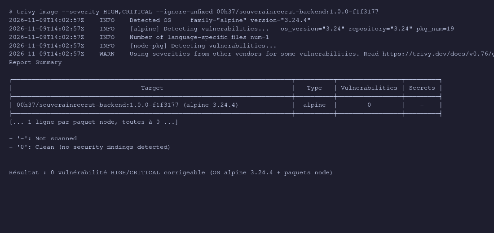
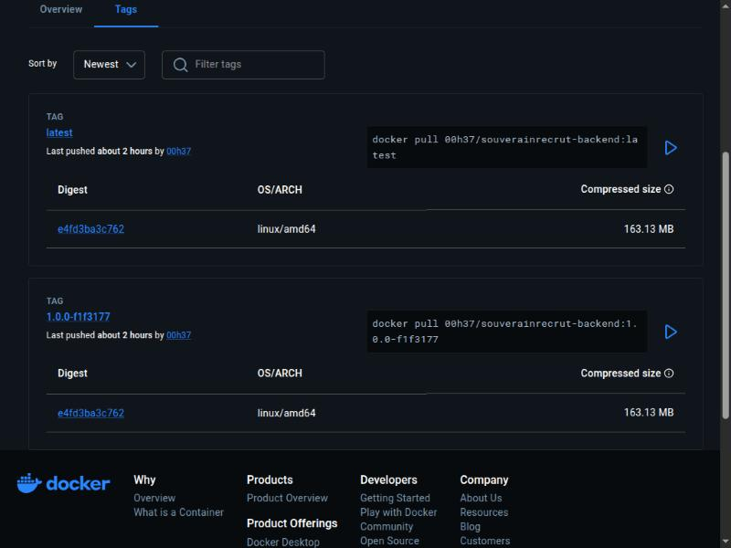
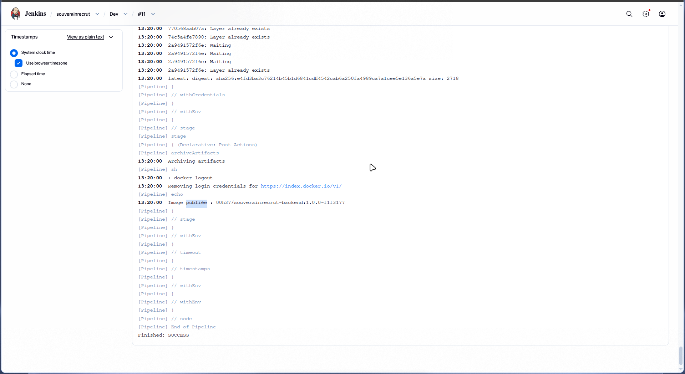

# Documentation technique – Intégration continue SouverainRecrut (Backend)

| | |
|---|---|
| **Module** | CI/CD – Mastère M2 (RNCP 40166) – Sup de Vinci Rennes |
| **Projet** | Projet fil rouge SouverainRecrut – périmètre Backend uniquement |
| **Auteur** | Léo Bessin |
| **Date** | 9 novembre 2026 (journée 1 : intégration continue) |
| **Dépôt** | `github.com/LeoBessin/souverainrecrut` (fork de `Santoudllo/souverainrecrut`), branche `Dev` |
| **Périmètre couvert** | Cahier des charges, partie 3 (§3.1 à §3.6) |

> Les captures sont dans `docs/captures/`. Celles encore à fournir sont listées en annexe.

---

## 1. Objectif et synthèse

L'objectif de la journée était de mettre en place la chaîne d'intégration continue du Backend : le code est testé, analysé par SonarQube, conteneurisé, scanné par Trivy puis publié sur Docker Hub, le tout piloté par Jenkins.

```
GitHub (branche Dev)
   └─► Jenkins (Jenkinsfile)
         ├─ Checkout + calcul du tag  <version>-<commit>
         ├─ npm ci  →  prisma generate  →  tsc
         ├─ Tests Vitest + couverture (lcov)
         ├─ SonarQube  →  Quality Gate (bloquant)
         ├─ docker build
         ├─ Trivy (HIGH/CRITICAL corrigeables bloquants)
         └─ docker push  →  Docker Hub  (Dev uniquement)
```

| Exigence du cahier des charges | Réalisation | Fichier(s) |
|---|---|---|
| §3.1 Préparation du dépôt | Fork, branche `Dev`, `npm ci`, `prisma generate` | – |
| §3.2 Tests Backend + couverture | Vitest + Supertest, 52 tests, couverture lcov | `backend/tests/`, `backend/vitest.config.ts` |
| §3.3 SonarQube + Quality Gate | SonarQube Community en Docker, projet configuré | `docker-compose.sonarqube.yml`, `sonar-project.properties` |
| §3.4 Jenkins | Jenkins LTS en Docker, plugins préinstallés, credentials | `docker-compose.jenkins.yml`, `jenkins/Dockerfile`, `docs/jenkins.md` |
| §3.5 Automatisation CI | Pipeline déclaratif complet | `Jenkinsfile` |
| §3.6 Image Docker | Dockerfile multi-étapes durci, tags traçables, Trivy, push | `backend/Dockerfile`, `backend/.dockerignore` |

---

## 2. Préparation du dépôt (§3.1)

- Fork personnel du dépôt officiel, remotes : `origin` (fork) et `upstream` (dépôt Santoudllo).
- Travail sur la branche `Dev`.
- Prérequis locaux : Git, Node.js 22, Docker, comptes GitHub et Docker Hub.

```bash
git clone https://github.com/LeoBessin/souverainrecrut.git
cd souverainrecrut && git checkout Dev
cd backend && npm ci && npx prisma generate
```

---

## 3. Tests automatisés du Backend (§3.2)

### 3.1 Choix techniques

Les scripts de test du dépôt d'origine étaient des placeholders. Choix retenus :

| Besoin | Outil | Justification |
|---|---|---|
| Framework de test | **Vitest** | Support natif de TypeScript, rapide, API compatible Jest |
| Tests HTTP | **Supertest** | Appels réels sur l'application Express sans ouvrir de port |
| Couverture | `@vitest/coverage-v8` | Rapport `lcov` directement lisible par SonarQube |
| Base de données | **Mock Prisma** (`tests/setup.ts`) | Tests exécutables en CI sans PostgreSQL |

Scripts npm : `npm test` (`vitest run`) et `npm run test:coverage` (`vitest run --coverage`).

### 3.2 Refactorisation associée

Pour rendre le code testable et réduire la duplication, les quatre contrôleurs et fichiers de routes (utilisateurs, candidats, offres, candidatures) ont été factorisés dans `crud.controller.ts` et `crud.routes.ts`.
Le dossier `tests` a été exclu de la compilation (`tsconfig.json`) afin que `npm run build` ne compile que `src`.

### 3.3 Contenu des tests

| Fichier | Périmètre |
|---|---|
| `tests/api.test.ts` | Authentification, CRUD utilisateurs/candidats/offres/candidatures, codes 400/401/403/404/409, statistiques du tableau de bord |
| `tests/middlewares.test.ts` | Authentification JWT, contrôle des rôles, gestion des erreurs |
| `tests/validators.test.ts` | Schémas de validation Zod |
| `tests/utils.test.ts` | Fonctions utilitaires |

### 3.4 Résultats (exécution du 9/11/2026)

**4 fichiers de test, 52 tests réussis.**

| Métrique | Valeur |
|---|---|
| Statements | 97,18 % (242/249) |
| Branches | 81,15 % (56/69) |
| Functions | 97,64 % (83/85) |
| Lines | 97,18 % |

`server.ts`, `src/docs/**` et `src/types/**` sont exclus de la mesure (démarrage du serveur, Swagger, types).



---

## 4. Analyse qualité avec SonarQube (§3.3)

### 4.1 Mise en place

SonarQube Community et sa base PostgreSQL sont lancés avec `docker-compose.sonarqube.yml` (volumes persistants, healthcheck sur la base) :

```bash
docker compose -f docker-compose.sonarqube.yml up -d    # http://localhost:9000
```

### 4.2 Configuration de l'analyse (`sonar-project.properties`)

| Paramètre | Valeur |
|---|---|
| `sonar.projectKey` | `souverainrecrut` |
| `sonar.sources` | `backend/src,frontend/src` |
| `sonar.tests` / inclusions | `backend/tests`, `**/*.test.ts` |
| `sonar.exclusions` | `node_modules`, `dist`, migrations Prisma, `src/docs` |
| `sonar.coverage.exclusions` | `server.ts`, docs, types, frontend |
| `sonar.javascript.lcov.reportPaths` | `backend/coverage/lcov.info` |

Le Frontend est hors périmètre fonctionnel du projet : il est exclu de la mesure de couverture.

### 4.3 Webhook et Quality Gate

L'étape `waitForQualityGate` de Jenkins exige un webhook SonarQube → Jenkins (`http://jenkins:8080/sonarqube-webhook/`). SonarQube bloquant par défaut les webhooks vers une adresse interne, la variable `SONAR_VALIDATEWEBHOOKS: "false"` a été ajoutée au compose (environnement local de TP uniquement).

Résultat de l'analyse (4,7 k lignes TypeScript) : **Quality Gate Passed**, couverture 92,2 %, duplications 1,4 %, Sécurité B (1 problème), Fiabilité C (16), Maintenabilité A (2).
La couverture SonarQube (92,2 %) diffère de celle de Vitest (97,18 %) car SonarQube applique ses propres exclusions et calcule sur les lignes et conditions du rapport lcov.



---

## 5. Mise en place de Jenkins (§3.4)

### 5.1 Installation

`jenkins/Dockerfile` part de `jenkins/jenkins:lts-jdk21`, ajoute `docker-cli` et `git`, et préinstalle les plugins : Git, Pipeline (workflow-aggregator), GitHub, NodeJS, SonarQube Scanner, Docker Pipeline, Credentials Binding, Timestamper.

`docker-compose.jenkins.yml` :
- ports 8080 (interface) et 50000 (agents) ;
- volume `jenkins_home` pour la persistance ;
- montage de `/var/run/docker.sock` pour que le pipeline pilote le Docker de l'hôte (**choix de TP**, voir §9 sur les limites) ;
- rattachement au réseau `souverainrecrut_default` de SonarQube pour joindre `http://sonarqube:9000` ;
- DNS fixes (1.1.1.1 / 9.9.9.9) : résout un problème de DNS périmé quand le portable change de réseau.

```bash
docker compose -f docker-compose.sonarqube.yml up -d
docker compose -f docker-compose.jenkins.yml up -d --build   # http://localhost:8080
```



### 5.2 Configuration (aucun secret dans le dépôt)

| Où | Nom | Valeur |
|---|---|---|
| Tools > NodeJS | `nodejs-22` | NodeJS 22.x |
| Tools > SonarQube Scanner | `sonar-scanner` | installation automatique |
| System > SonarQube servers | `sonarqube` | `http://sonarqube:9000` + jeton (Secret text) |
| Credentials | `dockerhub-credentials` | Username/Password : compte Docker Hub + access token |
| Job | Multibranch Pipeline | Source GitHub (fork), Script Path `Jenkinsfile` |

Les jetons sont stockés dans le coffre de Jenkins et injectés par `withCredentials` ; les valeurs sont masquées dans les journaux.





---

## 6. Pipeline Jenkins (§3.5)

Le `Jenkinsfile`, versionné à la racine, est un pipeline déclaratif. Options : horodatage, un seul build à la fois, timeout global 30 min, conservation des 10 derniers builds.

| # | Étape | Action | Condition d'échec |
|---|---|---|---|
| 1 | Checkout | `checkout scm`, calcul du tag `IMAGE_TAG = <version package.json>-<commit court>` | – |
| 2 | Install | `npm ci` | Erreur de dépendances |
| 3 | Prisma generate | `npx prisma generate` (URL de base factice, aucune connexion) | – |
| 4 | Build TypeScript | `npm run build` | Erreur de compilation |
| 5 | Tests + couverture | `npm run test:coverage` | Un test échoue |
| 6 | SonarQube | `sonar-scanner` via `withSonarQubeEnv` | – |
| 7 | Quality Gate | `waitForQualityGate abortPipeline: true` (timeout 10 min) | Statut ≠ Passed |
| 8 | Docker build | Tags `<image>:<version>-<commit>` et `:latest` | Erreur de build |
| 9 | Scan Trivy | Rapport complet (non bloquant) puis contrôle bloquant | CVE HIGH/CRITICAL corrigeable |
| 10 | Push Docker Hub | `docker login` + push des deux tags, **uniquement sur la branche `Dev`** | Authentification refusée |

Post-actions : archivage de `backend/coverage/**` et `reports/**` (rapport Trivy), `docker logout`.

La publication est donc conditionnée à la réussite de tous les contrôles : toute étape en échec interrompt le pipeline avant l'étape 10.

Historique : 10 builds (#2 à #11). Les builds #2 à #10 ont échoué pendant la mise au point (configuration, vulnérabilités Trivy, authentification Docker Hub, voir §7 et §8). Le build **#11 est réussi** (durée 2 min 11 s) ; il a déclenché le Quality Gate (Passed) et le push de l'image.





---

## 7. Image Docker et sécurité (§3.6)

### 7.1 Dockerfile (`backend/Dockerfile`)

Build multi-étapes sur `node:22-alpine` :

1. **builder** : `npm ci`, `prisma generate`, `npm run build` ;
2. **runner** : `npm ci --omit=dev`, copie de `dist`, `prisma` et du client Prisma généré uniquement.

Durcissements :
- `NODE_ENV=production` ;
- suppression de **npm/npx** de l'image finale (inutiles à l'exécution, réduisent la surface d'attaque et les CVE embarquées) ;
- exécution avec l'utilisateur non-root **`node`** ;
- `.dockerignore` : exclut `node_modules`, `dist`, `coverage`, `tests`, `.env*` (sauf `.env.example`), `.git`, journaux → image reproductible, sans fichier ni secret superflu.

### 7.2 Traçabilité des tags

Chaque image est taguée `00h37/souverainrecrut-backend:<version>-<commit>` (ex. `1.0.0-f1f3177`), plus `latest`. Le tag relie l'image à la version applicative et au commit exact, ce qui permettra le rollback (partie 2 du projet).

### 7.3 Politique de sécurité Trivy

| Paramètre | Valeur | Raison |
|---|---|---|
| Sévérités | `HIGH,CRITICAL` | Seuil bloquant retenu |
| `--ignore-unfixed` | oui | On ne bloque que sur les failles pour lesquelles un correctif existe |
| `--exit-code 1` | oui | Fait échouer le build |
| Rapport complet | `reports/trivy-report.txt` (table, non bloquant) | Conservé comme artefact |

### 7.4 Remédiation des vulnérabilités (commit `89a5989`)

Le premier scan a fait échouer le pipeline. Corrections apportées :
- `npm audit fix` : mise à jour des dépendances vulnérables (`proxy-addr`, `body-parser`, `zod`, `morgan`, …) ;
- `overrides` npm : `deepmerge-ts ^8.0.2` ;
- retrait de npm de l'image finale et passage à l'utilisateur `node`.



---

## 8. Publication sur Docker Hub et incidents rencontrés

L'étape de push utilise `withCredentials` (`dockerhub-credentials`) et `--password-stdin` (le jeton n'apparaît ni dans la ligne de commande, ni dans les journaux).

Plusieurs échecs d'authentification ont nécessité des correctifs successifs (commits du 9/11, 13h05 → 13h17) :

| Commit | Problème / diagnostic | Correctif |
|---|---|---|
| `d555db9` | Caractères parasites collés au jeton ; DNS périmé dans Jenkins | Nettoyage des identifiants avant `docker login` ; DNS fixes |
| `d2ea0ab` | Tentative de conservation de la casse du login (`LeoBessin`) | Annulée ensuite |
| `4a4c377` | Caractères Unicode invisibles possibles | Filtrage `tr -cd '[:graph:]'` + diagnostic sans fuite (longueur du jeton, préfixe `dckr_pat_`) |
| `5b93046` | L'API d'authentification Docker Hub répond *malformed HTTP Authorization header* si le login contient des majuscules | Login forcé en minuscules |
| `f1f3177` | Le nom du dépôt doit commencer par l'**identifiant Docker Hub réel** (`00h37`), différent du pseudo GitHub | `DOCKERHUB_USER = '00h37'` ; l'image est poussée sous cet espace de noms |

Résultat vérifié : les tags `1.0.0-f1f3177` et `latest` (même digest `e4fd3ba3c762`, 163 Mo) sont publiés sur `00h37/souverainrecrut-backend`.


Le journal du build #11 confirme la fin du push (digest `sha256:e4fd3ba3c762…`, tag `latest`), la déconnexion Docker (`docker logout`), le message `Image publiée : 00h37/souverainrecrut-backend:1.0.0-f1f3177` et `Finished: SUCCESS`.



---

## 9. Limites, choix de TP et points d'attention

- **Socket Docker monté dans Jenkins, exécuté en root** : acceptable pour un TP local, mais donne à Jenkins le contrôle de l'hôte. En production : agents dédiés, Docker rootless ou build sans démon (Kaniko, BuildKit).
- **Mocks Prisma** : les tests ne valident pas les requêtes SQL réelles ni les migrations ; des tests d'intégration avec PostgreSQL de test seraient un complément.
- **`aquasec/trivy:latest`** et `sonarsource/sonar-scanner-cli:latest` ne sont pas épinglés : à figer par version pour une reproductibilité stricte.
- **Branches** : seule `Dev` publie ; les autres branches s'arrêtent avant le push.
- **Webhook SonarQube non validé** (`SONAR_VALIDATEWEBHOOKS=false`) : réservé à l'environnement local.
- **Frontend** : le dossier `frontend/src` figure encore dans `sonar.sources` ; il est exclu de la couverture mais pourrait être retiré des sources pour respecter strictement le périmètre Backend.

---

## 10. Reproduction complète

```bash
# 1. Outils de qualité et CI
docker compose -f docker-compose.sonarqube.yml up -d
docker compose -f docker-compose.jenkins.yml up -d --build

# 2. Configuration Jenkins/SonarQube : voir §5.2 et docs/jenkins.md
# 3. Lancer le job Multibranch sur la branche Dev
# 4. Vérifier : Quality Gate Passed, rapport Trivy, image sur Docker Hub
```

Test local sans Jenkins :

```bash
cd backend && npm ci && npx prisma generate && npm run test:coverage
docker build -t 00h37/souverainrecrut-backend:local .
```

---

## 11. Journée 2 – Provisionnement, configuration et déploiement (§4 et §5)

> Choix d'environnement : pas de VMware ni de lab. Le serveur cible est un **VPS Debian 12 existant** (le cahier des charges cite Ubuntu ; les playbooks utilisent `ansible_distribution` pour rester compatibles) (§4.1 remplacé par ce VPS ; la création initiale de la machine est manuelle, comme le prévoit le cahier des charges quand l'hyperviseur ne permet pas l'automatisation). Terraform et Ansible sont exécutés depuis le poste de travail ; GitLab CI déclenche le déploiement sur le serveur.

### 11.1 Vue d'ensemble

| Outil | Rôle | Emplacement |
|---|---|---|
| Terraform | Bootstrap du VPS : utilisateur `deploy`, clé SSH dédiée générée, sudo, inventaire Ansible | `deploiement/terraform/` |
| Ansible | Préparation du serveur (Docker, Compose, répertoire) puis déploiement du Backend | `deploiement/ansible/` |
| Docker Compose | Backend (image Docker Hub versionnée) + PostgreSQL + migrations Prisma | `deploiement/deployment/` |
| GitLab CI/CD | Valide le tag, se connecte en SSH, exécute Ansible, vérifie l'API, permet le rollback | `.gitlab-ci.yml` |

```
Poste local : terraform apply ─► utilisateur deploy + clé SSH + inventaire
Poste local : ansible-playbook playbook.yml ─► VPS prêt (une fois)

Jenkins ─► Docker Hub (image X.Y.Z-commit)
GitLab CI : validate:tag ─► [approbation manuelle] deploy:production ─► verify:production
                                     │ SSH + Ansible
                                     ▼
              VPS : docker login ─► pull ─► migrate (Prisma) ─► up ─► /v1/health
```

### 11.2 Prérequis poste local

Terraform et Ansible sont installés sur le poste (binaire Terraform HashiCorp vérifié par SHA-256 dans `~/.local/bin` ; `ansible-core` via `uv tool install`).

### 11.3 Terraform (§4.2)

Fichiers : `providers.tf`, `variables.tf`, `main.tf`, `outputs.tf`. Providers `tls` et `local` ; le VPS étant déjà créé chez l'hébergeur, la ressource pilotée est son **bootstrap** (`terraform_data` + `remote-exec`), idempotent (utilisateur créé s'il n'existe pas).

- Clé SSH ED25519 dédiée au déploiement générée par Terraform, écrite dans `.secrets/deploy_key` (0600, hors Git).
- Inventaire Ansible généré (`inventories/prod/hosts.ini`, hors Git).
- `deploy` a un sudo sans mot de passe (nécessaire à Ansible ; à restreindre en production réelle).
- Le state contient la clé privée : exclu de Git ; en équipe, utiliser un backend distant chiffré.

```bash
cd deploiement/terraform
cp terraform.tfvars.example terraform.tfvars   # server_host, bootstrap_user, clé de bootstrap
terraform init && terraform validate && terraform plan && terraform apply
```

### 11.4 Ansible (§4.3)

- `playbook.yml` (rôle `server_prep`, tag `prepare`) : mise à jour apt, dépendances, Docker Engine + plugin Compose depuis le dépôt officiel (si absents), service activé et démarré, répertoire `/opt/souverainrecrut`, contrôles `docker info` et `docker compose version`.
- `deploy.yml` (rôle `app_deploy`) : refuse un tag vide ou `latest`, copie Compose et migrations Prisma, mémorise le tag précédent (`.previous_tag`), génère le `.env` (0600), login Docker Hub, `pull` + `up`, attente de `/v1/health`.
- Secrets : en local via Ansible Vault (`vault.yml`, variables `vault_*`) ; en CI via les variables GitLab masquées (lues par `lookup('env')`). `no_log` sur les tâches sensibles.

```bash
cd deploiement/ansible
ansible-galaxy collection install -r requirements.yml
ansible app -m ping
ansible-playbook playbook.yml --tags prepare --check --diff
ansible-playbook playbook.yml --tags prepare
```

### 11.5 Docker Compose et migrations (§5.2)

Services `db` (PostgreSQL 16, volume `pgdata`, healthcheck), `migrate` (`prisma migrate deploy`, exécuté une fois avant l'API ; l'image de production n'embarque pas la CLI Prisma) et `api` (image Docker Hub, healthcheck, `restart: unless-stopped`). Limite : un rollback d'image n'annule pas les migrations de schéma déjà appliquées (§5.4).

### 11.6 GitLab CI/CD (§4.4 et §5.3)

Le fichier `.gitlab-ci.yml` ne reconstruit pas l'image. Stages :

1. `validate:tag` : tag non vide, ≠ `latest`, format `X.Y.Z-<commit>`, existence sur Docker Hub, `--syntax-check` Ansible, ping SSH.
2. `deploy:production` : **manuel** (approbation), `resource_group` pour éviter les déploiements concurrents ; exécute `playbook.yml --tags prepare` puis `deploy.yml`.
3. `verify:production` : `docker compose ps` et `curl /v1/health` sur le serveur.
4. `rollback:production` : manuel, avec `ROLLBACK_TAG`.

Variables CI/CD à créer (masquées, `SSH_PRIVATE_KEY` de type File) : `DOCKERHUB_USER`, `DOCKERHUB_TOKEN`, `SSH_HOST`, `SSH_USER`, `SSH_PRIVATE_KEY`, `POSTGRES_PASSWORD`, `JWT_SECRET`, `FRONTEND_URL`, `IMAGE_TAG`. Un seul serveur est disponible : pas d'environnement de staging distinct.

### 11.7 État d'avancement

| Élément | État |
|---|---|
| Fichiers Terraform / Ansible / Compose / `.gitlab-ci.yml` écrits | Fait |
| YAML valide (parsing) | Vérifié |
| `terraform validate` (Terraform 1.17.1), `ansible-playbook --syntax-check` (ansible-core 2.21) | Réussis |
| `terraform apply` sur le VPS (Debian 12, 4 ressources créées : utilisateur `deploy`, clé SSH, inventaire) | Fait |
| `playbook.yml --tags prepare` sur le VPS (1re exécution `changed=4`, 2e exécution `changed=0` : idempotent) | Fait |
| `deploy.yml` : image `00h37/souverainrecrut-backend:1.0.0-f1f3177` déployée, `db` et `api` *healthy*, migration Prisma appliquée, `/v1/health` et `/v1/ready` = 200, endpoints protégés = 401 | Fait |
| Run GitLab, rollback testé | À faire |
| Procédure de rollback testée | À faire |

### 11.8 Déploiement réalisé (10/11/2026)

Déploiement manuel depuis le poste, avec les secrets applicatifs générés aléatoirement et conservés dans `ansible/.deploy-secrets.env` (hors Git), injectés par variables d'environnement. Le dépôt Docker Hub étant public, la connexion Docker Hub est conditionnelle au jeton (`dockerhub_token`). Deux correctifs issus du premier run : le `.env`, `docker-compose.yml` et `prisma/` appartiennent à l'utilisateur `deploy` (sinon `docker compose ps` échouait en CI). Le port 4000 est publié sur toutes les interfaces : à restreindre (pare-feu ou reverse proxy TLS) pour un usage réel.

### Captures à fournir (journée 2)

- `12-terraform-plan.png` : `terraform plan` puis `apply`
- `13-ansible-prepare.png` : récapitulatif de `playbook.yml`
- `14-gitlab-variables.png` : variables CI/CD (valeurs masquées)
- `15-gitlab-pipeline.png` : pipeline avec le job manuel de production
- `16-deploiement-vps.png` : `docker compose ps` sur le VPS
- `17-api-health.png` : `curl /v1/health`

---

## Annexe – Chronologie des commits du 9 novembre 2026

| Heure | Commit | Description |
|---|---|---|
| 12:17 | `697be4c` | Tests backend, SonarQube, Jenkinsfile, Dockerfile Node 22 |
| 12:54 | `89a5989` | Correction des vulnérabilités Trivy, durcissement de l'image |
| 13:05 | `d555db9` | Nettoyage des identifiants Docker Hub, DNS fixe |
| 13:09 | `d2ea0ab` | Conservation de la casse du login |
| 13:10 | `4a4c377` | Filtrage ASCII + diagnostic |
| 13:13 | `5b93046` | Login en minuscules |
| 13:17 | `f1f3177` | Push sous l'identifiant Docker Hub réel |
